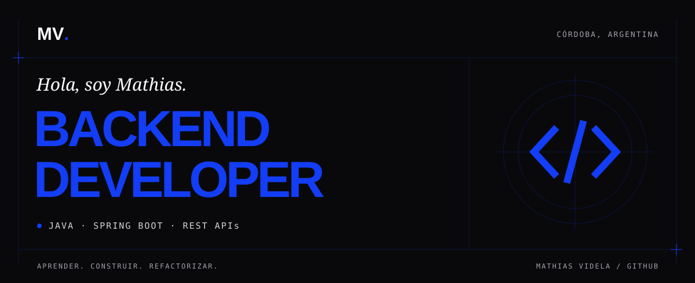

<!-- Visual identity inspired by mathiasvideladev.vercel.app: #09090b / #133df6 / #fafafa. -->

  
  
  

 

### 01 / DETRÁS DEL CÓDIGO

Soy **Mathias Videla**, estudiante de Desarrollo de Software en Argentina, enfocado en **backend con Java y Spring Boot**. Me interesan las APIs, los modelos de datos y las arquitecturas que hacen que un producto funcione bien por dentro.

Aprendo construyendo proyectos reales: entender el problema, escribir una solución clara y mejorarla con cada iteración.

> **Aprender → Construir → Refactorizar → Repetir.**

 

### 02 / HERRAMIENTAS

 

### 03 / EN CONSTRUCCIÓN

- APIs REST con contratos claros y arquitectura en capas.
- Persistencia de datos con **Spring Data JPA + MySQL**.
- Autenticación, gestión de usuarios y código mantenible.

<b>Notas de aprendizaje ↗</b>

- Validaciones y manejo de errores útiles.
- Modelado de bases de datos y estrategias de persistencia.
- Autenticación, autorización y seguridad de aplicaciones.
- Flujos de despliegue y herramientas de desarrollo.
- Fundamentos de frontend para comprender el producto completo.

 

<b>04 / ACTIVIDAD EN GITHUB</b>

 

  
  
  

 

---

  MATHIAS VIDELA · CÓRDOBA, ARGENTINA  
  <b>¿Una idea, una oportunidad o un proyecto para construir?</b> 
  <a href="mailto:mathiasvidela20@gmail.com">Conversemos ↗</a> &nbsp;·&nbsp; <a href="https://mathiasvideladev.vercel.app/">Conocé mi trabajo ↗</a>

